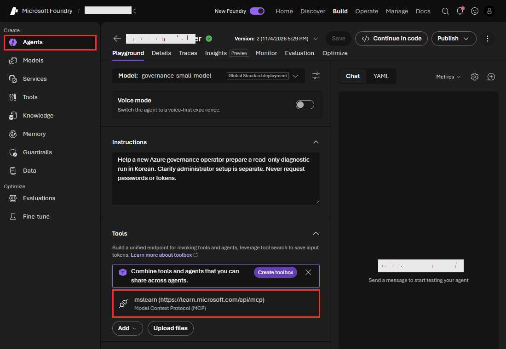
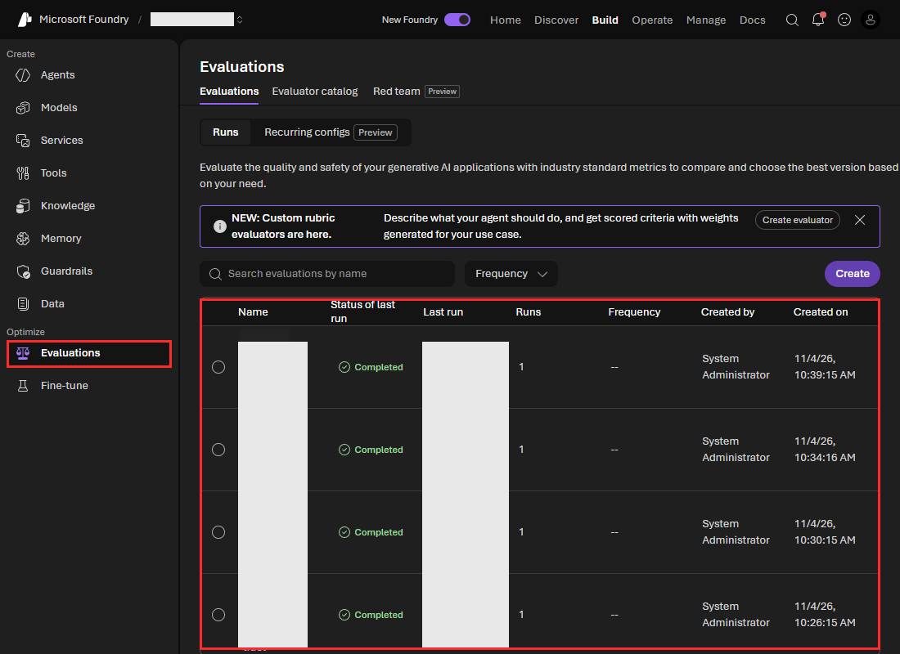
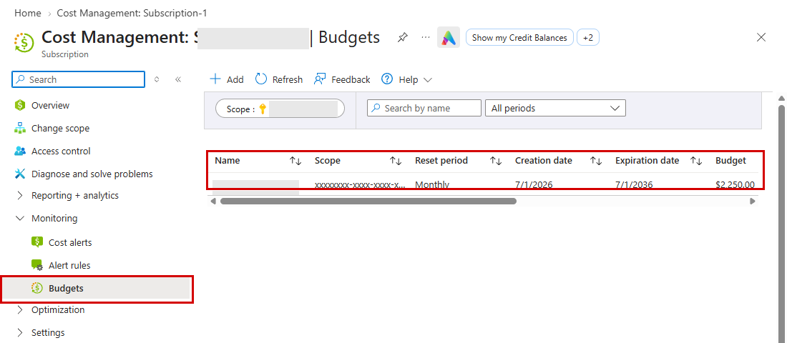

# 점검 항목 상세 (System Evidence 26개)

[요약·실행 절차](../README.md#점검-항목-system-evidence-26개) | [평가 규칙](api-notes.md#평가-규칙)

충족률 = 충족 분자 / 측정 분모. 조회 실패·빈 분모는 `null`이며 구성·기록을 실행 성공·정책 승인으로 해석하지 않습니다. 실제 규칙·임계값은 [criteria.yaml](../config/criteria.yaml)이 기준입니다.

## DM-SY-01 Agent 관리 인벤토리 등록·기본정보 완전성

| 구분 | 내용 |
| --- | --- |
| 충족 분자 | 등록 ID·플랫폼·생성 시각이 확인된 Agent 패키지 수 |
| 측정 분모 | Agent 365에서 플랫폼이 식별된 Agent 패키지 수 |
| 확인 근거 | Agent 365 catalog의 id·platform·createdDateTime |
| 한계 | 등록부 관리 범위이며 원본 플랫폼 전체 Agent 수·실행 성공을 뜻하지 않음 |

## DS-SY-02 데이터 정책(DLP) 적용 환경

| 구분 | 내용 |
| --- | --- |
| 충족 분자 | 데이터 정책(DLP)이 적용된 환경 수 |
| 측정 분모 | 관리자에게 보이는 Power Platform 환경 수 |
| 확인 근거 | 관리자 환경·DLP API의 AllEnvironments·OnlyEnvironments·ExceptEnvironments와 대상 ID |
| 한계 | 적용 범위만 확인. 커넥터 분류·차단 효과·정책 승인 아님 |

## DS-SY-03 Agent 등록 출처·플랫폼 유형 식별

| 구분 | 내용 |
| --- | --- |
| 충족 분자 | 플랫폼·패키지 유형과 적용 가능한 연결 공급자·원본 저장소가 확인된 패키지 수 |
| 측정 분모 | Agent 365에서 플랫폼이 식별된 Agent 패키지 수 |
| 확인 근거 | catalog platform·type 및 이기종 연결 정의의 등록 유형·공급자·원본 저장소 |
| 한계 | 등록 출처 기록이며 Entra 청사진·공급자 신뢰성·정책 승인의 증거가 아님 |

## DS-SY-04 플랫폼별 모델·오케스트레이션 구성

| 구분 | 내용 |
| --- | --- |
| 충족 분자 | 플랫폼별 모델 구성 정보가 확인된 대상 수 |
| 측정 분모 | Azure 모델 배포·Copilot Agent 및 Bedrock 등록 패키지 수 |
| 확인 근거 | Azure 모델 배포 구성·Copilot model/orchestration·Agent 365 Bedrock 정의 SourceIds.mac.modelInfo |
| 한계 | Copilot은 모델 레이블·오케스트레이션, Bedrock은 Agent 365 정의의 mac.modelInfo만 확인. 실제 모델 버전·정책 승인·퇴역 대응 아님 |

## DS-SY-05 플랫폼별 접근 범위 구성

| 구분 | 내용 |
| --- | --- |
| 충족 분자 | 플랫폼별 접근 범위 조건을 충족한 대상 수 |
| 측정 분모 | AI 계정·Copilot Agent 및 외부 동기화 패키지 수 |
| 확인 근거 | Azure 비공개 인바운드·접근 제한, Copilot authentication·sharedWithViewers.entireTenant, 외부 Agent 365 availableTo·isBlocked의 명시적 구성 기록 |
| 한계 | Copilot 인증·전체 공유 제한, 이기종 접근·차단 기록을 각각 확인. 원본 IAM·격리·공유 승인 아님 |

## DS-SY-06 도구 승인·사용자 동의 구성

| 구분 | 내용 |
| --- | --- |
| 충족 분자 | 플랫폼별 승인·동의 조건을 충족한 도구 수 |
| 측정 분모 | MCP 도구 및 활성 Copilot 커넥터 작업 수 |
| 확인 근거 | Azure MCP require_approval=always 및 Copilot 커넥터 requiresEndUserConsent |
| 한계 | 사용자 동의는 실행별 사람 승인과 다름. 비활성·함수·내장 도구 제외. 200개 제한·건수 불일치는 보류 |

## DS-SY-07 외부 도구·Agent HTTPS 연결 구성

| 구분 | 내용 |
| --- | --- |
| 충족 분자 | 유효한 HTTPS·인증정보 없음이 확인된 외부 도구·Agent URL 수 |
| 측정 분모 | 명시적 외부 도구 URL 및 Snowflake Agent endpoint 수 |
| 확인 근거 | 도구 server_url·url 또는 Agent 365 정의의 AgentEndpoints.EndpointUrl. 경로·인증값·URL 원문 미저장 |
| 한계 | 엔드포인트 업무 승인·상대 서버 신뢰·인증 성공을 뜻하지 않음 |

## BI-SY-08 Agent 등록·게시·배포 상태 기록

| 구분 | 내용 |
| --- | --- |
| 충족 분자 | 적용 가능한 원본 게시 상태 또는 등록부 배포 상태가 명시된 패키지 수 |
| 측정 분모 | Agent 365에서 플랫폼이 식별된 Agent 패키지 수 |
| 확인 근거 | 이기종 PublishedStatus 또는 MS 패키지 deployedTo |
| 한계 | Published·Draft·미배포 등 상태 기록의 완전성. 원본 관리형 환경·배포 승인·실행 성공과 다름 |

## BI-SY-09 플랫폼별 완료 평가 실행 기록

| 구분 | 내용 |
| --- | --- |
| 충족 분자 | 완료된 평가 실행을 보유한 대상 수 |
| 측정 분모 | Foundry 프로젝트 및 평가 기록 확인 대상 Copilot Agent 수 |
| 확인 근거 | Foundry 평가 완료 상태, Copilot 공식 기존 평가 GET의 Completed·endTime 또는 승인된 실제 검토 화면의 No evaluation run |
| 한계 | Standard 기본, 다른 하니스는 직접 증적 필요. 성공한 빈 목록은 0건·실패는 미확인. 새 평가 실행·품질 통과·배포 전 평가 증명 아님 |

## BI-SY-10 Agent 관리자 사용 차단 상태 기록

| 구분 | 내용 |
| --- | --- |
| 충족 분자 | 관리자 사용 차단 여부가 명시된 패키지 수 |
| 측정 분모 | Agent 365에서 플랫폼이 식별된 Agent 패키지 수 |
| 확인 근거 | catalog isBlocked |
| 한계 | true·false 상태 기록만 확인. 보안 평가·취약점·네이티브 플랫폼 접근 차단의 실효성은 별도 |

## BI-SY-11 콘텐츠 필터 정책 연결

| 구분 | 내용 |
| --- | --- |
| 충족 분자 | 활성 필터 정책이 연결된 배포 수 |
| 측정 분모 | 모델 배포 수 |
| 확인 근거 | deployments.raiPolicyName과 accounts/raiPolicies의 name·contentFilters.enabled 대조 |
| 한계 | 필터 실제 차단 효과·강도 승인을 뜻하지 않음 |

## BI-SY-12 플랫폼별 Agent 버전·게시 기록

| 구분 | 내용 |
| --- | --- |
| 충족 분자 | 플랫폼별 버전·게시 기록을 보유한 대상 수 |
| 측정 분모 | Foundry Agent·Copilot Agent 및 외부 동기화 패키지 수 |
| 확인 근거 | Foundry Agent version, Copilot lastPublishedAt, 외부 Agent 365 패키지 version |
| 한계 | 패키지 버전·Copilot 게시 시각의 존재만 확인. 원본 코드·모델 버전·운영 배포·승인·롤백 아님 |

## BI-SY-13 Agent 설명·실행 지침 메타데이터 기록

| 구분 | 내용 |
| --- | --- |
| 충족 분자 | 설명 또는 적용 가능한 원본 실행 지침이 비어 있지 않은 패키지 수 |
| 측정 분모 | Agent 365에서 플랫폼이 식별된 Agent 패키지 수 |
| 확인 근거 | MS shortDescription 존재 여부 또는 이기종 Instructions 존재 여부만 선별 저장 |
| 한계 | 존재 여부만 저장. 지침 품질·안전성·승인 아님. 소유자는 OE-SY-16에서 평가 |

## BI-SY-14 Agent 조직 배포 범위 구성 기록

| 구분 | 내용 |
| --- | --- |
| 충족 분자 | 배포 범위와 일부 배포 시 대상 기록이 일관된 패키지 수 |
| 측정 분모 | Agent 365에서 플랫폼이 식별된 Agent 패키지 수 |
| 확인 근거 | catalog deployedTo·acquireUsersAndGroups 건수 |
| 한계 | acquiredForNone도 명시된 구성. Azure Policy 준수·원본 AWS 또는 Snowflake 배포·사용량으로 해석하지 않음 |

## DP-SY-15 플랫폼별 Agent ID·청사진·원본 연결

| 구분 | 내용 |
| --- | --- |
| 충족 분자 | 플랫폼별 청사진 또는 원본 Agent 연결 기록이 확인된 대상 수 |
| 측정 분모 | Azure·Copilot Studio Agent 및 외부 등록 패키지 수 |
| 확인 근거 | Azure·Copilot의 실제 청사진 연결 또는 Agent 365 정의의 SourceAgentId·SourceIds.ConnectionId 연결 기록 |
| 한계 | 외부 원본 연결은 Entra Agent ID·청사진·실행 인증 연결을 뜻하지 않음. Agent Builder 신원 필드 미적용은 제외 |

## OE-SY-16 Agent 책임 주체 지정 기록

| 구분 | 내용 |
| --- | --- |
| 충족 분자 | 소유자가 1개 이상 기록된 패키지 수 |
| 측정 분모 | Agent 365에서 플랫폼이 식별된 Agent 패키지 수 |
| 확인 근거 | catalog owners 건수 |
| 한계 | 명시적 소유자 0개는 미충족. 필드 미확인은 null. 재직·스폰서 지정·업무 책임 승인은 추론하지 않음 |

## OE-SY-17 Agent 허용·배포·공유 대상 구분

| 구분 | 내용 |
| --- | --- |
| 충족 분자 | 허용·배포·공유 대상 건수와 사용자·그룹 구분이 확인된 패키지 수 |
| 측정 분모 | Agent 365에서 플랫폼이 식별된 Agent 패키지 수 |
| 확인 근거 | allowedUsersAndGroups·acquireUsersAndGroups·sharedWithUsersAndGroups의 최소화된 건수 |
| 한계 | 명시적 빈 목록과 미조회는 구분. 원본 IAM·Snowflake 역할·최소 권한 적정성으로 해석하지 않음 |

## OE-SY-18 Agent 중앙 등록부 변경 이력 추적

| 구분 | 내용 |
| --- | --- |
| 충족 분자 | 동일 테넌트의 완료된 두 API 스냅샷 사이에서 비교된 패키지 수 |
| 측정 분모 | Agent 365에서 플랫폼이 식별된 Agent 패키지 수 |
| 확인 근거 | 이전·현재 API 목록 증적과 등록·변경·목록 제외 비교 기록 |
| 한계 | 등록부 변경 이력이며 실행 로그·동기화 작업 감사 로그가 아님. 목록 제외는 원본 삭제 증거가 아님 |

## OE-SY-19 플랫폼별 인증·권한 구성

| 구분 | 내용 |
| --- | --- |
| 충족 분자 | 플랫폼별 인증·권한 구성이 확인된 대상 수 |
| 측정 분모 | AI 계정 및 Copilot 인벤토리 Agent 수 |
| 확인 근거 | Azure 관리 ID(identity.principalId·type), 동일 구독 roleAssignments, disableLocalAuth 및 Copilot 인벤토리 authentication |
| 한계 | 플랫폼별 조건·단위가 다름. 타 구독·상속·데이터 평면 역할·로그인 성공 제외 |

## OE-SY-20 AI 리소스 활성 경보 범위

| 구분 | 내용 |
| --- | --- |
| 충족 분자 | 활성 경보 범위에 포함된 AI 계정 수 |
| 측정 분모 | AI 계정 수 |
| 확인 근거 | metricAlerts·scheduledQueryRules·activityLogAlerts의 enabled와 scopes를 실제 AI 리소스 ID에 대조 |
| 한계 | 경보 발생·SLO 충족·trace 유입을 뜻하지 않음 |

## OE-SY-21 AI 경보의 작업 그룹·수신자 연결

| 구분 | 내용 |
| --- | --- |
| 충족 분자 | 작업 그룹·수신자가 연결된 경보 수 |
| 측정 분모 | AI 대상 경보 수 |
| 확인 근거 | 경보 actionGroupId·actionGroups와 email·SMS·webhook·armRole·Function·LogicApp·ITSM receivers |
| 한계 | 실제 전달 성공·온콜 대응 시간·복구 시험을 뜻하지 않음 |

## OE-SY-22 플랫폼별 지역·보존 구성 정보

| 구분 | 내용 |
| --- | --- |
| 충족 분자 | 플랫폼별 지역·보존 정보 조건을 충족한 대상 수 |
| 측정 분모 | AI 계정·Copilot Agent 및 Bedrock 등록 패키지 수 |
| 확인 근거 | Azure 지역·workspace 보존·Copilot 관리자 환경 azureRegion·Agent 365 Bedrock 정의 SourceIds.mac.region |
| 한계 | Copilot은 관리 환경 지역, Bedrock은 Agent 365 정의의 mac.region만 확인. 실제 모델 처리 지역·로그 보존 준수·법적 삭제 아님 |

## OT-SY-23 Agent 등록정보 생성·갱신 시각 관리

| 구분 | 내용 |
| --- | --- |
| 충족 분자 | 생성·최종 수정 시각이 순서에 맞고 API 관측 시각 이내인 패키지 수 |
| 측정 분모 | Agent 365에서 플랫폼이 식별된 Agent 패키지 수 |
| 확인 근거 | catalog createdDateTime·lastModifiedDateTime 및 Agent 365 수집 시각 |
| 한계 | 메타데이터 시각의 기록·일관성만 확인. 실제 사용량·마지막 실행·휴면·정기 동기화를 추론하지 않음 |

## OT-SY-24 AI 비용의 단일 Agent 귀속

| 구분 | 내용 |
| --- | --- |
| 충족 분자 | 단일 Agent에 귀속 확인된 비용 금액 |
| 측정 분모 | 동일 통화의 양수 AI 비용 금액 |
| 확인 근거 | Cost Management Daily query의 ResourceId·UsageDate·Cost·Currency와 Agent/모델 ID 대조 |
| 한계 | 공유 모델 비용은 중복 배분하지 않으며 통화 혼재·음수 조정·분모 0은 산출하지 않음 |

## OT-SY-25 AI 민감 데이터 노출 점검 구성

| 구분 | 내용 |
| --- | --- |
| 충족 분자 | AI 위협 방지·CSPM·민감 데이터 검색이 활성화된 구독 수 |
| 측정 분모 | 승인 구독 수 |
| 확인 근거 | Microsoft.Security pricings의 AI 플랜 pricingTier, CloudPosture 플랜 pricingTier와 SensitiveDataDiscovery 확장 isEnabled |
| 한계 | Defender 플랜·확장 구성만 확인. 실제 노출·조치·모든 AI 리소스 적용 범위 아님 |

## OT-SY-26 구독 예산·실제·예측 경보 구성

| 구분 | 내용 |
| --- | --- |
| 충족 분자 | 예산·경보가 구성된 구독 수 |
| 측정 분모 | 승인 구독 수 |
| 확인 근거 | budgets amount·category·timePeriod·filter와 활성 notifications의 thresholdType·threshold·수신자 존재 |
| 한계 | Agent별 예산이나 통보 후 자동 조치·실제 전달 성공을 뜻하지 않음 |

