# 점검 항목 상세 (System Evidence 26개)

[요약표·실행 절차](../README.md#점검-항목-system-evidence-26개) | [API·평가 계약](api-notes.md#심사기준-검토와-점수-반영-2026-11-05)

항목명은 평가표 기준이며 **실제 계산 범위는 각 항목의 점검 내용·한계를 따릅니다.** ✅는 수집 구현 여부이지 고객 환경의 충족 여부가 아닙니다. 등급은 API 충족률로 정하며(0% L1, 80% 미만 L2, 90% 미만 L3, 100% 미만 L4, 100% L5), **조회 실패·필수 필드 미확인·빈 분모는 `null`과 사유를 유지**하고 L1·0%로 바꾸지 않습니다. L5도 조직 승인·정책 실효성·자동화 동작을 입증하지 않습니다.

Excel 6번 상단에서 범위·보류 항목을, 7번에서 계산값·대상별 판정·직접 증적·기준 출처를 확인합니다. 아래 포털 경로는 참고용이며 캡처는 데모 환경(빨간 네모는 확인 위치, 식별자 마스킹)입니다.

## DM-SY-01 Copilot Studio 제작 권한 보유자 수 및 환경 현황

- **영역·제품:** Demand / Power Platform
- **구현:** ✅ 구현
- **점검 내용:** 관리자에게 보이는 환경별 역할 할당 존재 여부를 확인합니다. 공식 명령은 비 Dataverse 환경만 반환하며, 역할 건수가 확인되지 않은 환경을 0건으로 간주하지 않습니다. 중복 역할도 있어 실제 제작자 수로 해석하지 않습니다.
- **비율 평가 기준:** (역할 할당이 1건 이상인 환경 수 / 관리자에게 보이는 환경 수) × 100. 환경 목록이나 대상별 역할 건수가 미확인이면 점수를 보류합니다.
- **Azure Portal 기준(참고):** 해당 없음 - Power Platform 관리 센터 > 환경

## DS-SY-02 커넥터 분류·차단 정책(데이터 정책) 적용 현황

- **영역·제품:** Design / Power Platform 데이터 정책
- **구현:** ✅ 구현
- **점검 내용:** 관리자 내보내기의 DLP 정책 적용 범위(전체·포함·제외)로 환경별 적용 여부를 확인합니다. 커넥터 분류·차단 효과는 평가하지 않습니다.
- **비율 평가 기준:** (정책 범위에 포함되는 환경 수 / 관리자에게 보이는 환경 수) × 100. 정책이 없으면 0%이며, 환경 목록이나 정책 조회가 미완료이면 점수를 보류합니다.
- **Azure Portal 기준(참고):** 해당 없음 - Power Platform 관리 센터 > 정책 > 데이터 정책

## DS-SY-03 Agent ID의 Blueprint 연결

- **영역·제품:** Design / Microsoft Entra Agent ID
- **구현:** ✅ 구현
- **점검 내용:** Agent ID가 실제로 존재하는 에이전트 ID 청사진(Blueprint)에 연결됐는지 확인합니다. 청사진 수·조직 표준 승인 여부는 평가하지 않습니다.
- **비율 평가 기준:** (존재하는 청사진에 연결된 Agent ID 수 / 조회한 전체 Agent ID 수) × 100.
- **Azure Portal 기준(참고):** Azure Portal > Microsoft Entra ID > Agent ID > Blueprint 목록

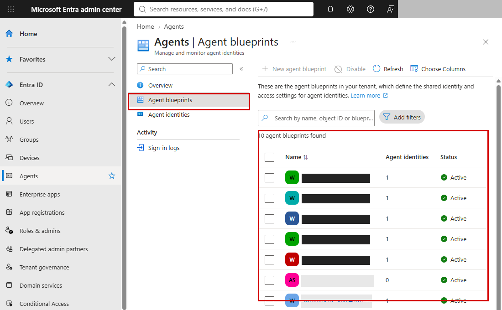

## DS-SY-04 모델 배포 버전·업데이트 구성

- **영역·제품:** Design / Microsoft Foundry
- **구현:** ✅ 구현
- **점검 내용:** 모델명·버전·형식과 기준에서 인식하는 업데이트 옵션을 확인합니다. 조직의 모델 승인·지원 종료 대응 여부는 평가하지 않습니다.
- **비율 평가 기준:** (모델명·버전·형식과 업데이트 옵션이 모두 확인된 모델 배포 수 / 조회한 전체 모델 배포 수) × 100.
- **Azure Portal 기준(참고):** Azure Portal > Microsoft Foundry > (계정) > Go to Foundry portal > 모델 + 엔드포인트(배포 목록·업데이트 옵션)

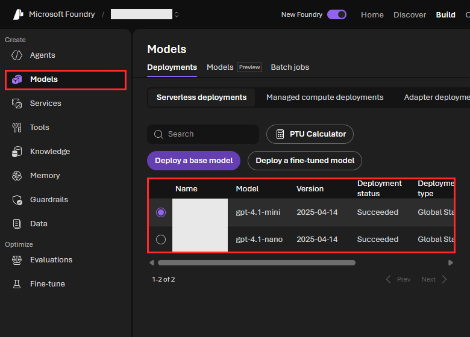

## DS-SY-05 AI 리소스 인바운드 경계 구성

- **영역·제품:** Design / AI 계정·자체 Agent 호스트
- **구현:** ✅ 구현
- **점검 내용:** AI 계정은 공용 접근 비활성·승인된 프라이빗 엔드포인트 연결을, 자체 호스트는 공용 접근 차단 또는 기본 거부 접근 제한을 확인합니다. 전체 주소 허용·VNet 통합·HTTPS만으로는 충족하지 않으며 실제 차단 시험은 아닙니다.
- **비율 평가 기준:** (위 네트워크 접근 제한 조건을 충족한 리소스 수 / 점검 대상 AI 계정·자체 Agent 호스트 수) × 100.
- **Azure Portal 기준(참고):** Azure Portal > Microsoft Foundry > (계정) > Resource Management > Networking, App Service > (앱) > Networking

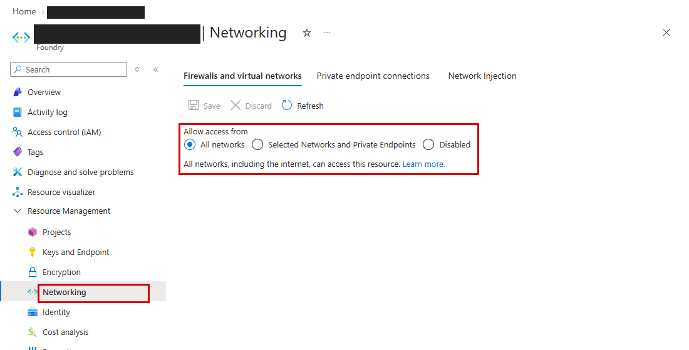

## DS-SY-06 MCP 도구 필수 승인 모드

- **영역·제품:** Design / Microsoft Foundry Agent 도구
- **구현:** ✅ 구현
- **점검 내용:** 최신 Agent 버전의 MCP 도구가 `require_approval=always`인지 확인합니다. 승인 없음·일부 호출 승인은 미충족입니다. 함수·내장 도구는 제외하며 런타임 승인 우회는 시험하지 않습니다.
- **비율 평가 기준:** (항상 승인을 요구하는 MCP 도구 설정 수 / 최신 Agent 버전에서 조회한 전체 MCP 도구 설정 수) × 100.
- **Azure Portal 기준(참고):** Azure Portal > Microsoft Foundry > (계정) > Go to Foundry portal > (프로젝트) > Agents > (Agent) > Tools

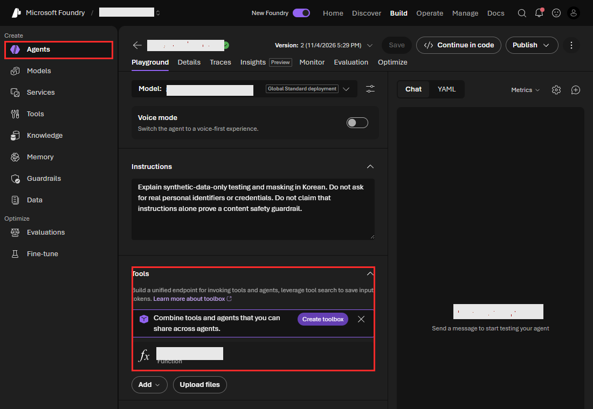

## DS-SY-07 외부 도구 HTTPS 연결 구성

- **영역·제품:** Design / Microsoft Foundry Agent 도구
- **구현:** ✅ 구현
- **점검 내용:** 외부 도구 URL의 HTTPS·유효한 서버 주소·URL 내 인증정보 부재를 모두 확인합니다. 경로·쿼리·인증정보는 저장하지 않으며 접속 성공·서버 신뢰성은 평가하지 않습니다.
- **비율 평가 기준:** (HTTPS·유효한 서버 주소·URL 내 인증정보 없음 조건을 모두 충족한 URL 수 / 명시적으로 설정된 전체 외부 도구 URL 수) × 100.
- **Azure Portal 기준(참고):** Azure Portal > Microsoft Foundry > (계정) > Go to Foundry portal > (프로젝트) > Agents > (Agent) > Tools(MCP)

## BI-SY-08 환경 분리 및 관리형 환경 적용 여부

- **영역·제품:** Build / Power Platform
- **구현:** ✅ 구현
- **점검 내용:** 관리자 내보내기의 `protectionLevel=Standard`를 관리형 환경으로 해석하고 환경 유형을 함께 표시합니다. 개발·테스트·운영의 실제 분리는 평가하지 않습니다.
- **비율 평가 기준:** (보호 수준이 `Standard`인 환경 수 / 관리자에게 보이는 환경 수) × 100. 보호 수준을 확인하지 못한 환경이 있으면 점수를 보류합니다.
- **Azure Portal 기준(참고):** 해당 없음 - Power Platform 관리 센터 > 환경 > 관리형 환경

## BI-SY-09 Foundry 프로젝트 평가 실행 이력

- **영역·제품:** Build / Microsoft Foundry
- **구현:** ✅ 구현
- **점검 내용:** 프로젝트별 완료·성공 상태의 평가 이력을 확인합니다. 프로젝트 읽기 권한이 필요하며 품질 통과·배포 전 평가·자동 평가 운영을 뜻하지 않습니다.
- **비율 평가 기준:** (완료·성공 상태의 평가 실행 기록이 있는 프로젝트 수 / 발견한 전체 Foundry 프로젝트 수) × 100.
- **Azure Portal 기준(참고):** Azure Portal > Microsoft Foundry > (계정) > Go to Foundry portal > Build > Evaluations

## BI-SY-10 AI 리소스 보안 권고 상태

- **영역·제품:** Build / Microsoft Defender for Cloud
- **구현:** ✅ 구현
- **점검 내용:** AI 리소스에 적용 가능한 권고의 `Healthy` 비율을 확인하며 적용 제외 권고는 분모에서 뺍니다. 권고 없음·상태 미확인은 보류합니다. 구독 보안 점수·조치 기한은 평가하지 않습니다.
- **비율 평가 기준:** (정상 상태인 보안 권고 수 / AI 리소스에 적용되는 전체 보안 권고 수) × 100.
- **Azure Portal 기준(참고):** Azure Portal > Microsoft Defender for Cloud > Recommendations(AI 리소스 필터), Security posture(보안 점수)

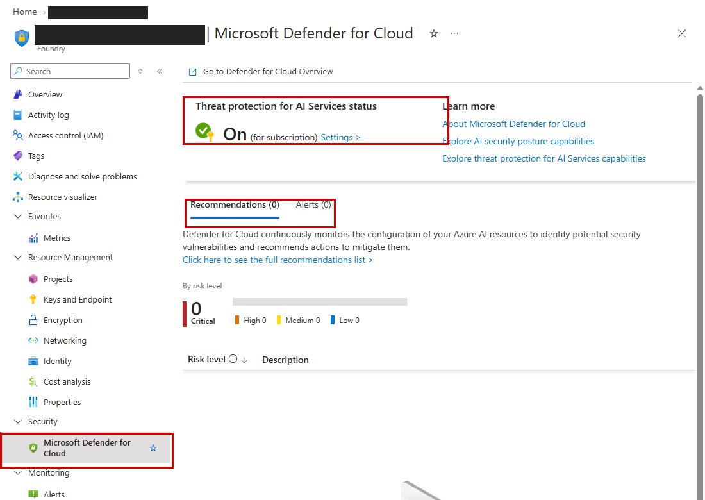

## BI-SY-11 콘텐츠 필터 정책 연결

- **영역·제품:** Build / Microsoft Foundry 콘텐츠 필터
- **구현:** ✅ 구현
- **점검 내용:** 모델 배포에 연결된 정책의 실재·필터 활성 상태를 확인합니다. 정책명만으로는 충족하지 않으며 실제 차단 효과·필터 강도 승인은 평가하지 않습니다.
- **비율 평가 기준:** (실제로 존재하고 활성 필터가 확인된 정책에 연결된 모델 배포 수 / 조회한 전체 모델 배포 수) × 100.
- **Azure Portal 기준(참고):** Azure Portal > Microsoft Foundry > (계정) > Go to Foundry portal > Build > Guardrails(콘텐츠 필터)

## BI-SY-12 Agent 버전·호스트 런타임 식별

- **영역·제품:** Build / Foundry·App Service·컨테이너
- **구현:** ✅ 구현
- **점검 내용:** Foundry Agent 버전, App Service의 버전 지정 런타임, 컨테이너 이미지 SHA256을 확인합니다. `latest` 같은 가변 지정은 미충족이며 소스 출처·배포 승인·복구 기록은 평가하지 않습니다.
- **비율 평가 기준:** (버전 또는 고유한 실행 이미지 식별 조건을 충족한 Agent·호스트 수 / 점검 대상 Foundry Agent 수와 자체 Agent 호스트 수의 합계) × 100.
- **Azure Portal 기준(참고):** Azure Portal > Microsoft Foundry > (계정) > Go to Foundry portal > 모델 + 엔드포인트(버전 업데이트 정책), App Service > (앱) > Settings > Configuration > Stack settings

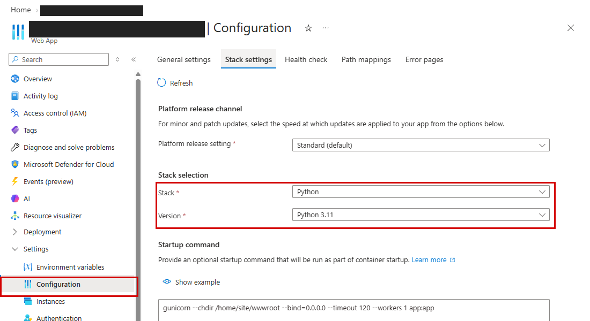

## BI-SY-13 Agent 책임·환경·비용 메타데이터

- **영역·제품:** Build / Azure 태그·Agent 메타데이터
- **구현:** ✅ 구현
- **점검 내용:** Agent별 소유자·스폰서·환경·비용센터를 태그 또는 Foundry 메타데이터에서 확인합니다. 기본 키는 `owner`·`sponsor`·`env`·`cost-center`이며 승인·재직·자산 대장 일치는 평가하지 않습니다.
- **비율 평가 기준:** (소유자·스폰서·환경·비용센터 정보가 모두 있는 Azure Agent 수 / 조회한 전체 Azure Agent 수) × 100.
- **Azure Portal 기준(참고):** Azure Portal > Microsoft Foundry 또는 App Service > (리소스) > Tags

## BI-SY-14 AI 리소스 정책 평가 준수

- **영역·제품:** Build / Azure Policy
- **구현:** ✅ 구현
- **점검 내용:** AI 관련 리소스에 연결된 모든 정책 평가가 `Compliant`인지 확인합니다. 면제·미확인·평가 없음은 준수가 아니며 자동 교정 효과는 평가하지 않습니다.
- **비율 평가 기준:** (연결된 모든 정책 평가가 준수 상태인 리소스 수 / 정책 평가 대상인 AI 관련 리소스 수) × 100.
- **Azure Portal 기준(참고):** Azure Portal > Policy > Compliance

## DP-SY-15 Azure Agent의 Entra Blueprint 귀속

- **영역·제품:** Deploy / Microsoft Entra Agent ID
- **구현:** ✅ 구현 - 현재 API 기준 완료, 연결 충족률과 구현 여부는 별개
- **점검 내용:** Foundry Agent의 구독 ID·계정명·프로젝트명·Agent 이름을 청사진 태그와 정확히 대조하고 실제 Agent ID의 청사진 연결도 확인합니다. 두 Entra 목록의 전체 조회가 필요하며 호스트 관리 ID만으로는 인정하지 않습니다.
- **비율 평가 기준:** (위 이름·구독 정보와 실제 Agent ID 연결이 모두 확인된 Azure Agent 수 / 조회한 전체 Azure Agent 수) × 100. 전체 Agent 365 등록 패키지 수로 나누는 방식은 아닙니다.
- **Azure Portal 기준(참고):** Microsoft Entra ID > Agent ID.

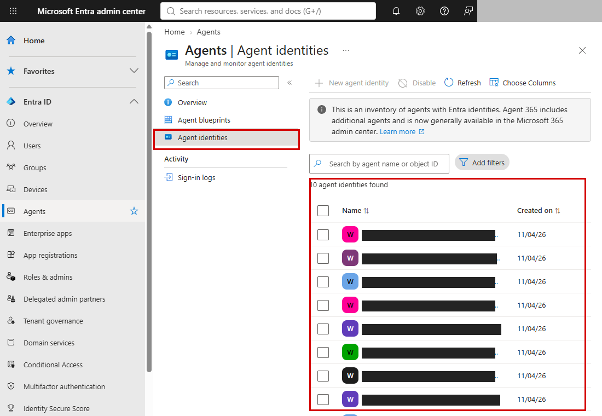

## OE-SY-16 Agent ID 소유자·스폰서 연결

- **영역·제품:** Operate / Microsoft Entra Agent ID
- **구현:** ✅ 구현
- **점검 내용:** 소유자·스폰서가 각각 1명 이상 연결됐는지 확인합니다. 사람 이름·로그인 ID는 저장하지 않으며 계정 활성·재직 여부는 평가하지 않습니다.
- **비율 평가 기준:** (소유자와 스폰서가 모두 연결된 Agent ID 수 / 조회한 전체 Agent ID 수) × 100.
- **Azure Portal 기준(참고):** Azure Portal > Microsoft Entra ID > Agent ID > (에이전트 ID) > 소유자/스폰서

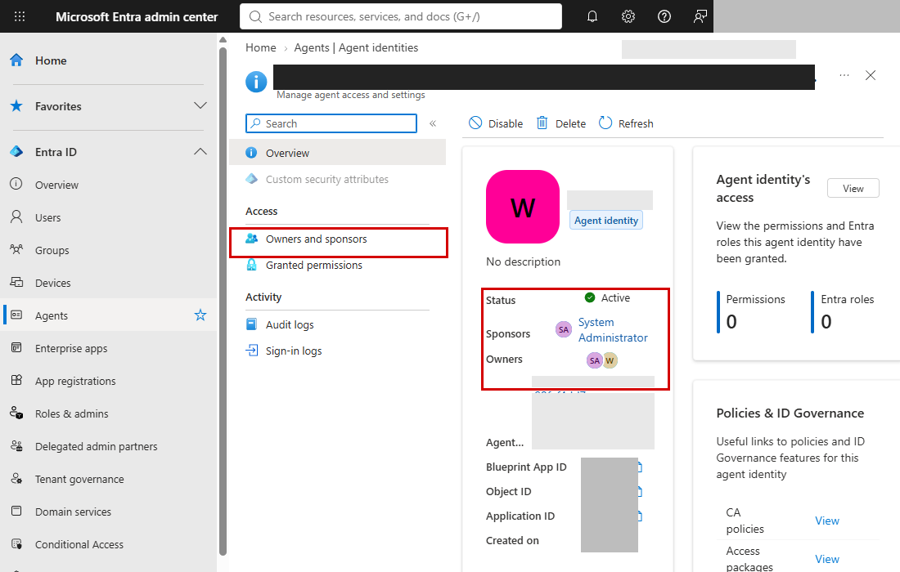

## OE-SY-17 Agent ID 앱 역할 읽기 범위

- **영역·제품:** Operate / Microsoft Entra Agent ID
- **구현:** ✅ 구현
- **점검 내용:** 기준의 쓰기·전체 제어 이름 패턴에 해당하는 앱 역할이 없는 Agent ID를 확인합니다. ARM 역할·위임 권한·앱 내부 권한은 제외합니다.
- **비율 평가 기준:** (기준의 쓰기·전체 제어 권한 패턴에 해당하는 앱 역할이 없는 Agent ID 수 / 조회한 전체 Agent ID 수) × 100.
- **Azure Portal 기준(참고):** Azure Portal > Microsoft Entra ID > Agent ID > (에이전트 ID) > 권한

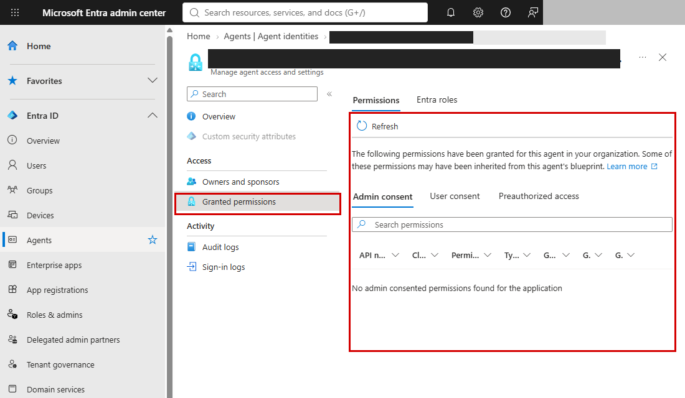

## OE-SY-18 Agent 리소스 실행 로그 연결

- **영역·제품:** Operate / Azure Monitor 진단 설정
- **구현:** ✅ 구현
- **점검 내용:** 활성 로그와 Log Analytics 작업 영역 연결을 확인합니다. 구독 활동 로그·실제 유입·테이블별 보존기간은 제외하며 승인 범위 밖 작업 영역의 조회 불가 사유는 유지합니다.
- **비율 평가 기준:** (로그 수집이 켜져 있고 Log Analytics 작업 영역이 연결된 리소스 수 / 점검 대상 AI 계정·자체 Agent 호스트 수) × 100.
- **Azure Portal 기준(참고):** Azure Portal > Microsoft Foundry > (계정) > Monitoring > Diagnostic settings, Log Analytics workspaces > (workspace) > Tables(보존 기간)

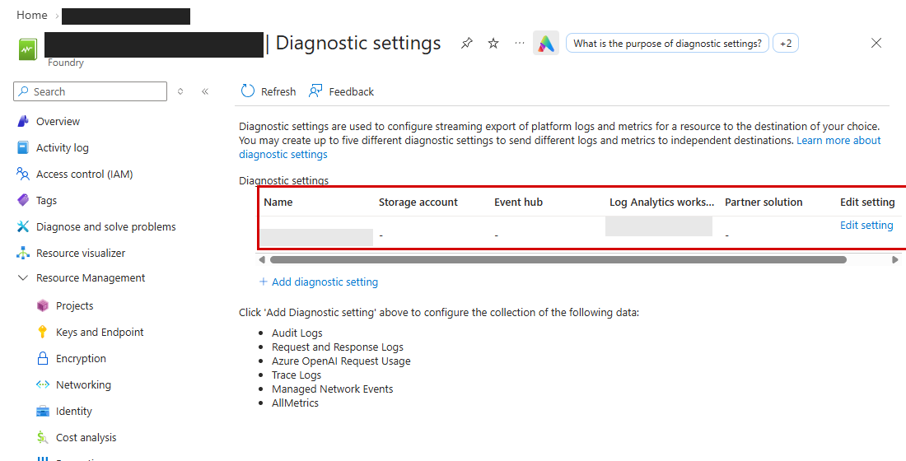

## OE-SY-19 관리 ID·키 인증·직접 ARM 역할 구성

- **영역·제품:** Operate / Azure Resource Graph·RBAC
- **구현:** ✅ 구현
- **점검 내용:** 관리 ID 연결·동일 구독의 광범위 직접 역할 부재를 확인하고 AI 계정은 키 인증 비활성도 요구합니다. 타 구독·상속·데이터 평면 역할과 실제 인증 사용은 제외합니다.
- **비율 평가 기준:** (관리 ID 연결·광범위 직접 역할 없음 조건을 충족하고, AI 계정이면 키 인증도 꺼져 있는 리소스 수 / 점검 대상 AI 계정·자체 Agent 호스트 수) × 100.
- **Azure Portal 기준(참고):** Azure Portal > Microsoft Foundry > (계정) > Resource Management > Identity, Access control (IAM) > Role assignments, Keys and Endpoint

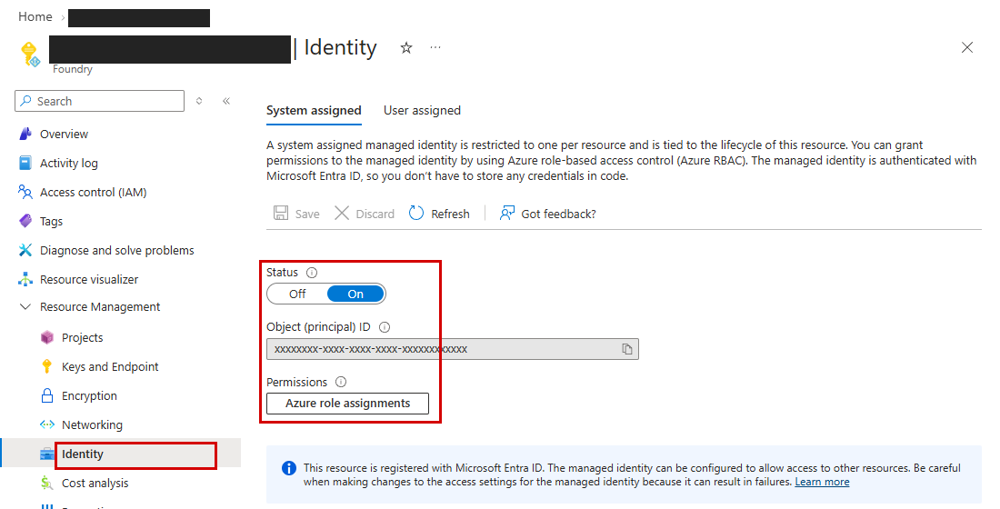

## OE-SY-20 AI 리소스 활성 경보 범위

- **영역·제품:** Operate / Azure Monitor
- **구현:** ✅ 구현
- **점검 내용:** 활성 메트릭·로그 검색·활동 로그 경보의 범위를 실제 AI 리소스 ID와 대조합니다. 경보 발생·서비스 목표·실행 추적 유입은 평가하지 않습니다.
- **비율 평가 기준:** (하나 이상의 활성 경보가 감시하는 리소스 수 / 점검 대상 AI 계정·자체 Agent 호스트 수) × 100.
- **Azure Portal 기준(참고):** Azure Portal > Monitor > Alerts > Alert rules, Application Insights, Microsoft Foundry > (계정) > Monitoring > Diagnostic settings

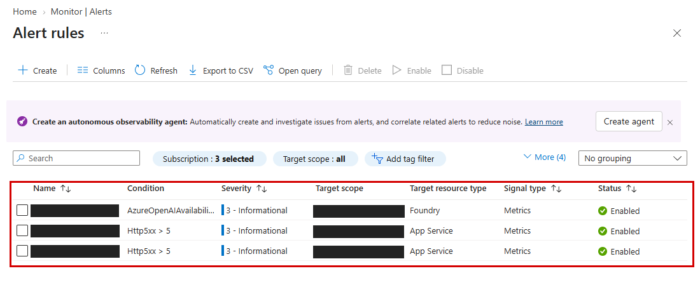

## OE-SY-21 AI 경보의 작업 그룹·수신자 연결

- **영역·제품:** Operate / Azure Monitor 작업 그룹
- **구현:** ✅ 구현
- **점검 내용:** AI 경보의 활성 상태·실재 작업 그룹·활성 수신자 연결을 확인합니다. 이름·주소는 저장하지 않으며 전달 성공·대응 시간·복구 결과는 평가하지 않습니다.
- **비율 평가 기준:** (활성 경보·작업 그룹·활성 수신자 연결 조건을 모두 충족한 경보 수 / AI 리소스를 대상으로 하는 전체 경보 수) × 100.
- **Azure Portal 기준(참고):** Azure Portal > Monitor > Alerts > Action groups

## OE-SY-22 리소스 지역·workspace 보존 구성

- **영역·제품:** Operate / Azure 리소스·Log Analytics
- **구현:** ✅ 구현 - 현재 API 기준 완료, 보존 기준 충족률과 구현 여부는 별개
- **점검 내용:** 배포 지역과 활성 로그 연결 작업 영역의 보존기간을 확인합니다. 기본 90일이며 여러 연결 중 최솟값을 사용합니다. 실제 모델 처리 지역·테이블별 보존·법적 삭제는 평가하지 않습니다.
- **비율 평가 기준:** (배포 지역이 확인되고 활성 로그 연결의 보존기간이 모두 기준 이상인 리소스 수 / 점검 대상 AI 계정·자체 Agent 호스트 수) × 100.
- **Azure Portal 기준(참고):** Azure Portal > Microsoft Foundry > (계정) > Overview(Location), Log Analytics workspaces > (workspace) > Tables(보존 기간)

## OT-SY-23 AI 리소스 사용량 관측 범위

- **영역·제품:** Optimize / Azure Monitor 메트릭
- **구현:** ✅ 구현
- **점검 내용:** 기본 30일 내 숫자 메트릭 표본의 존재를 확인합니다. 숫자 0도 관측값이지만 기록 없음은 다릅니다. Agent별 사용자 수·90일 미사용은 평가하지 않습니다.
- **비율 평가 기준:** (조회 기간에 숫자로 된 메트릭 측정값이 하나 이상 있는 리소스 수 / 점검 대상 AI 계정·자체 Agent 호스트 수) × 100.
- **Azure Portal 기준(참고):** Azure Portal > Microsoft Foundry > (계정) > Monitoring > Metrics, Logs

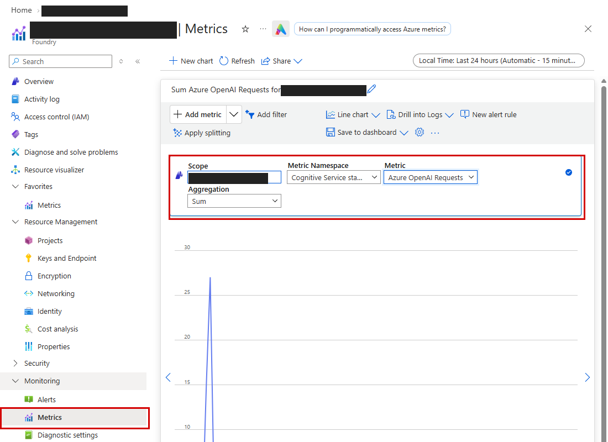

## OT-SY-24 AI 비용의 단일 Agent 귀속

- **영역·제품:** Optimize / Azure Cost Management
- **구현:** ✅ 구현
- **점검 내용:** 기본 30일의 AI 비용 중 사용일자가 있고 단일 Agent에 귀속되는 금액을 확인합니다. 공유 비용의 임의 배분·중복 계산은 금지하며 통화 혼재·음수 조정·총액 0은 보류합니다.
- **비율 평가 기준:** (사용일자가 있고 정확히 한 Agent에 연결되는 비용 금액 / 같은 통화로 조회한 전체 AI 관련 양수 비용 금액) × 100. 건수가 아닌 금액 기준입니다.
- **Azure Portal 기준(참고):** Azure Portal > Cost Management > Cost analysis, Budgets

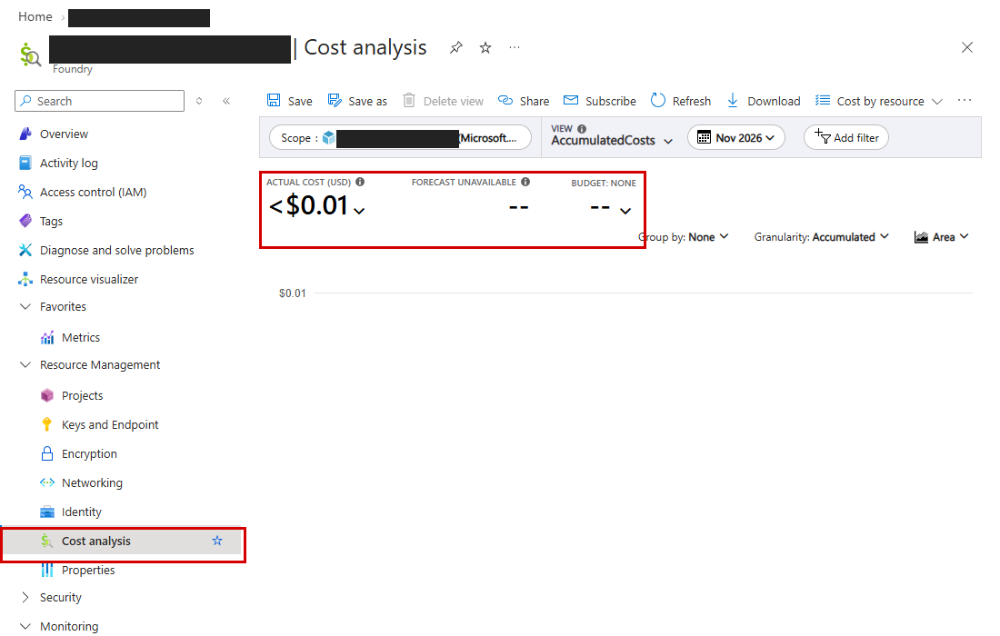

## OT-SY-25 AI 민감 데이터 노출 점검 구성

- **영역·제품:** Optimize / Microsoft Defender for Cloud
- **구현:** ✅ 구현
- **점검 내용:** 구독별 AI·Defender CSPM 플랜과 민감 데이터 검색 확장을 확인합니다. 프롬프트 증거·AI 모델 검사 확장은 상태만 기록합니다. 실제 경보·데이터 노출·모든 AI 리소스 적용 여부는 평가하지 않습니다.
- **비율 평가 기준:** (AI 플랜·CSPM 플랜이 Standard이고 민감 데이터 검색이 활성인 구독 수 / 점검 범위의 전체 승인 구독 수) × 100. 필드를 확인하지 못한 구독이 있으면 점수를 보류합니다.
- **Azure Portal 기준(참고):** Azure Portal > Microsoft Defender for Cloud > Environment settings > 구독 > Defender plans

## OT-SY-26 구독 예산·실제·예측 경보 구성

- **영역·제품:** Optimize / Azure Cost Management
- **구현:** ✅ 구현
- **점검 내용:** 현재 유효한 양수·무필터 비용 예산에 활성 실제·예측 경보의 임계값과 수신자가 있는지 확인합니다. 구독당 하나 이상이면 충족합니다. Agent별 예산·전달 성공·자동 조치는 평가하지 않습니다.
- **비율 평가 기준:** (위 예산·실제 비용 경보·예측 비용 경보·수신자 조건을 모두 충족한 구독 수 / 점검 범위의 전체 승인 구독 수) × 100.
- **Azure Portal 기준(참고):** Azure Portal > Cost Management > Budgets

