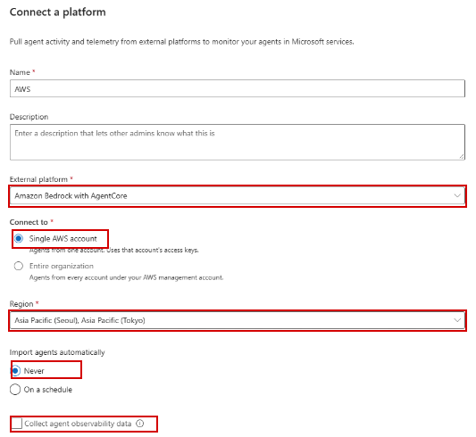
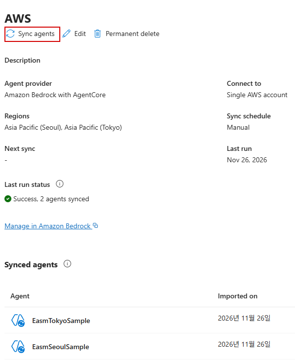
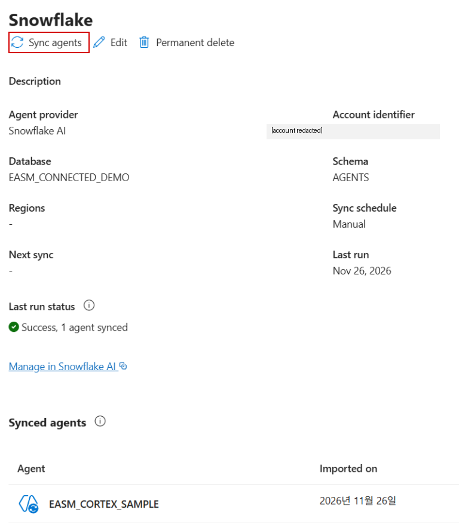
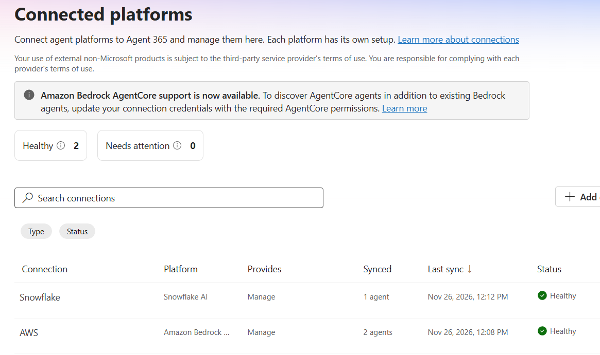

# 이기종 에이전트 연결·수집

**고객이 운영 중인 AWS·Snowflake 에이전트**를 Agent 365에 연결하고 읽기 전용으로 수집합니다. 에이전트 배포·모델 변경·실행 역할 변경은 이 절차에 포함하지 않습니다.

## 1. 대상·권한 확인

| 담당 | 확인할 내용 |
| --- | --- |
| 플랫폼 관리자 | 승인 AWS 계정·리전 또는 Snowflake 계정·DB·스키마, 대상 에이전트, 연결 전용 읽기 자격 증명 |
| AI 관리자 | 고객 테넌트의 Agent 365 라이선스, Microsoft 365 관리 센터의 Connected platforms 관리 권한 |
| 진단 담당자 | 진단 앱의 `CopilotPackages.Read.All` 읽기 권한·관리자 동의와 인증 준비 |

연결 범위·동기화할 메타데이터를 승인하고 기존 연결은 재사용합니다. 진단 앱에는 AWS·Snowflake 관리자 권한을 부여하지 않습니다.

## 2. 연결 자격 증명 준비

### Amazon Bedrock Agents Classic·AgentCore

루트·관리자 키가 아닌 **연결 전용 IAM 사용자**의 Access key ID·Secret access key를 사용합니다. 신규 사용자·키가 필요하면 플랫폼 관리자가 승인된 절차로 생성합니다.

| 읽기 범위 | 필요한 권한 |
| --- | --- |
| 리전 확인 | `ec2:DescribeRegions` |
| Classic | `bedrock:ListAgents`, `bedrock:GetAgent` |
| AgentCore | `bedrock-agentcore:ListHarnesses`, `bedrock-agentcore:GetHarness`, `bedrock-agentcore:ListAgentRuntimes`, `bedrock-agentcore:GetAgentRuntime` |

[공식 Bedrock 안내](https://learn.microsoft.com/en-us/microsoft-agent-365/admin/connected-platforms-amazon-bedrock)의 선택 유형만 허용합니다. 상세 조회는 승인 ARN으로 제한하며 Harness·Runtime ARN을 구분합니다. 호출·삭제 권한은 제외합니다.

### Snowflake Cortex Agents

승인 DB·스키마의 에이전트만 조회하는 **서비스 사용자와 RSA 키 쌍**을 사용합니다. 기존 연결용 키를 우선 사용하고, 신규 공개키 등록·회전은 고객의 자격 증명 관리 절차를 따릅니다.

| 항목 | 확인 |
| --- | --- |
| 계정 식별자 | Snowsight 계정 메뉴 → **View Account Details** |
| 읽기 역할 | 대상 DB·스키마 `USAGE`, 대상 Agent `MONITOR`. 관리자·Agent `MODIFY`·실행 권한은 제외 |
| 인증 | 서비스 사용자에 공개키 등록, 해당 개인키로 목록·상세 읽기 확인 |
| 개인키 | Agent 365 양식이 요구하는 PEM 내용 전체. 공개키나 Azure 진단 인증서를 대신 입력하지 않음 |

[RSA 인증](https://docs.snowflake.com/en/user-guide/key-pair-auth)·[Cortex 안내](https://learn.microsoft.com/en-us/microsoft-agent-365/admin/connected-platforms-snowflake-cortex)를 따릅니다. 운영 키를 재발급하거나 Azure 인증서와 공유하지 않습니다.

## 3. Agent 365 연결

[Microsoft 365 관리 센터](https://admin.cloud.microsoft/#/agents/all/connected-platforms?type=Platform)에서 **Agents → All Agents → Connected platforms → Manage → Connect a platform**을 엽니다.

| 양식 | 고객 환경 입력 |
| --- | --- |
| Amazon Bedrock with AgentCore | `Single AWS account`, 승인 리전 목록, 연결 전용 Access key ID·Secret access key |
| Snowflake Cortex | 계정 식별자, 대상 Database·Schema, 서비스 사용자, RSA 개인키 |
| 자동 가져오기 | 수동 검증은 `Never` 선택 |
| 활동 수집 | 승인되지 않았다면 선택 해제. 활성화는 로그 접근 범위·데이터 처리·추가 비용 검토 후 별도 승인 |

**키는 공식 연결 양식에만 입력합니다.** 채팅·보고서·스크린샷·저장소에는 저장하지 않습니다. 연결 생성·동기화의 공개 API는 확인되지 않아 이 단계는 관리 센터에서 수행합니다.



화면은 사용 방법 예시입니다. 식별자·키는 가렸으며 입력은 승인된 고객 값으로 바꿉니다.

## 4. 동기화 확인

**Validate → Save → Sync agents**를 실행합니다. 고객의 대상 목록과 등록부 결과를 대조하고, 에이전트 변경 후 기존 연결에서 재동기화합니다.

| 확인 | 기준 |
| --- | --- |
| 연결 상세 | `Success`, 최근 실행 시각, 예상 동기화 수, 대상 에이전트 목록 |
| 연결 목록 | `Healthy`, 조회 범위가 승인 계정·리전·DB·스키마와 일치 |
| API 결과 | 동일 패키지 ID의 목록·상세 읽기 성공. 이름으로 추정 매칭하지 않음 |







캡처의 빨간 네모는 클릭 위치입니다. 동기화 성공이 전체 필드 제공·통제 충족을 뜻하지는 않습니다.

## 5. 읽기 전용 수집

[README의 인증·권한 준비](../README.md#step-5)를 완료한 뒤 저장소 루트에서 실행합니다.

```bash
easm-agent collect --setup-file .easm-agent/setup.json \
  --agent365-registry --output-dir output
```

수집기는 Agent 365 Graph 목록·상세만 읽으며 AWS·Snowflake에 직접 접속하거나 에이전트를 호출하지 않습니다.

| 결과 | 확인할 내용 |
| --- | --- |
| 1a_플랫폼 기준 | Bedrock·Snowflake 등록 패키지 수. 고유·활성 Agent 수와 구분 |
| 2c_수집 매트릭스 | `A` API 확인, `X` 조회·확인 실패, `해당 없음` 범위 밖·API 필드 미지원. 사유는 비고·근거 참조 |
| 3_SE 판정 | 공통 등록부의 기본정보·출처·상태·차단·설명·배포 범위·소유자·대상 구분·변경 이력·시각을 평가. 원본 연결·버전·접근 구성도 반영하며 Bedrock 모델·리전, Snowflake HTTPS endpoint는 항목별 근거로 사용 |
| 근거·원본 시트 | 대상별 필드·출처·미제공 사유 |

필드 미확인은 사유를 유지합니다. 패키지 버전·소유자를 원본 코드·IAM·Snowflake 역할로 추론하지 않습니다. 출력은 XLSX·PPTX·JSON입니다.

## 문제 해결

| 상황 | 확인 |
| --- | --- |
| 인증 실패 | 키 상태·등록 공개키, 읽기 권한, 정확한 ARN, 조직 정책·권한 경계, 네트워크 제한 |
| 목록 누락 | 승인 범위, 동기화 시각, 원본 대상과 패키지 ID 대조 |
| 사용 집계 0 | 활동 활성화·기간·완전성을 확인하기 전 실제 실행 0회로 판정하지 않음 |
| 활동 수집 | AWS는 로그·Transaction Search 설정과 추가 비용 검토 필요. Snowflake 활동은 문서상 미지원 |

공식 참고: [Connected platforms](https://learn.microsoft.com/en-us/microsoft-agent-365/admin/connected-platforms) · [Graph API](https://learn.microsoft.com/en-us/microsoft-agent-365/admin/graph-api) · [평가 계약](./api-notes.md#이기종-agent)
